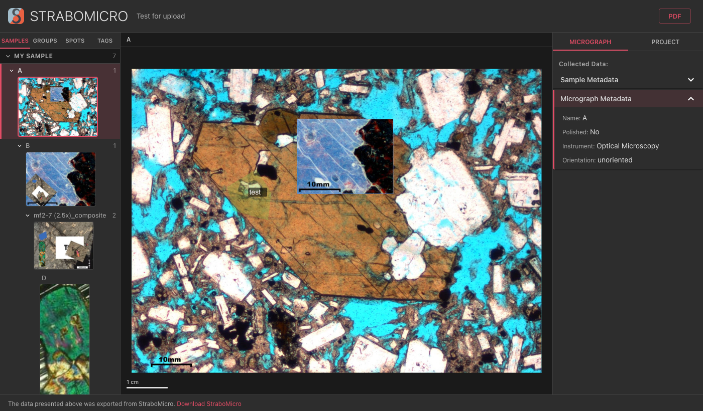
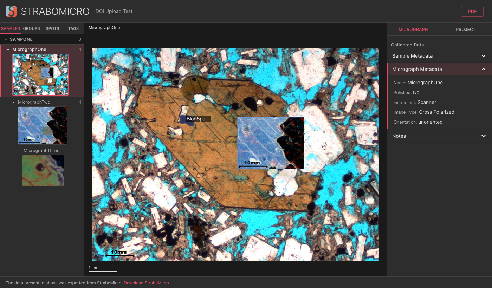
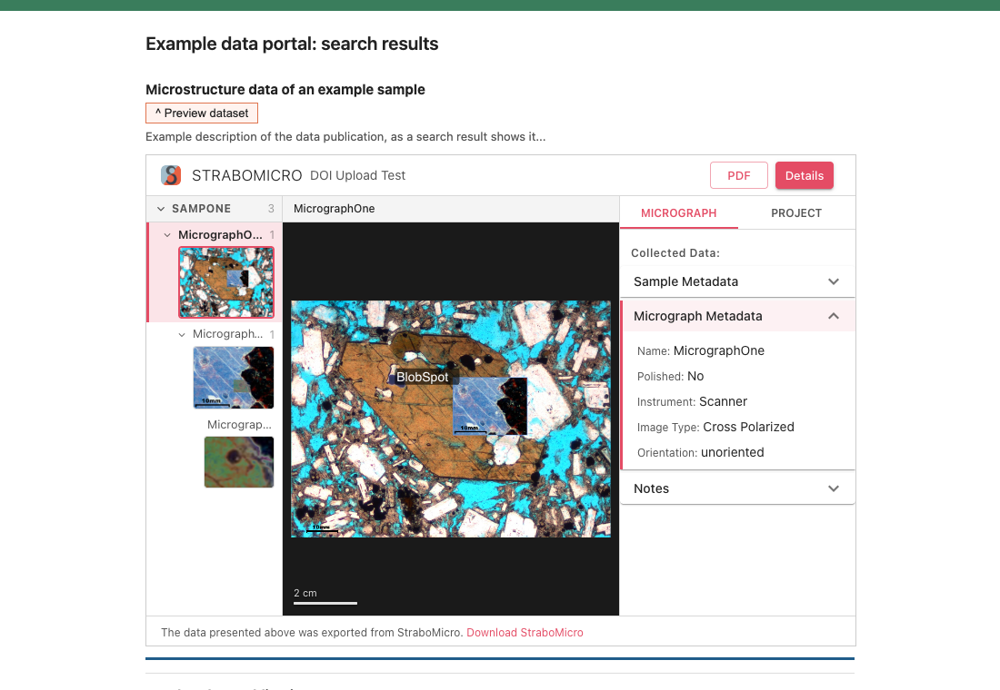
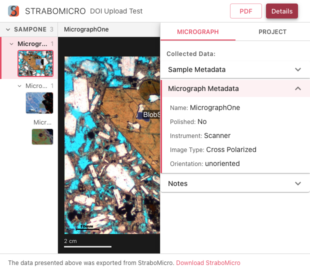

# StraboMicro Web Viewer

The StraboMicro Web Viewer shows StraboMicro projects in a web browser. Put it on any web server, add decompressed `.smz` project folders next to it, and open a project by its id. It is read-only: people can pan and zoom the micrographs, see spots, overlays and sketches, and browse all of the project's data, but they cannot change anything.

It needs only a web server that delivers files (Apache, nginx, IIS, GitHub Pages, ...). No PHP, no database, nothing to install on the server.

This is version 2, built from the same code as the viewer on [strabospot.org](https://strabospot.org). The earlier jQuery viewer is kept under the git tag `legacy-v1`.



## Contents

- [Quick start](#quick-start)
- [Which projects work](#which-projects-work)
- [Configuration](#configuration)
- [Embedding the viewer in another site](#embedding-the-viewer-in-another-site)
- [Downloads (PDF, SMZ, Share)](#downloads-pdf-smz-share)
- [Address parameters](#address-parameters)
- [Updating from the earlier viewer](#updating-from-the-earlier-viewer)
- [Building from source](#building-from-source)

## Quick start

1. Copy the files of this repository to a folder your web server delivers, for example `https://example.org/microviewer/`. You need `view.html`, `config.js`, `assets/` and `smzFiles/` (`embed-example.html` is optional).
2. Decompress each project into `smzFiles/`. A `.smz` file is a ZIP archive: rename it to `.zip` and extract it. It holds one folder named by the project id, which contains `project.json`. Copy that folder into `smzFiles/`:

   ```
   microviewer/
     view.html
     config.js
     assets/
     smzFiles/
       17176049358379/          <- one folder per project
         project.json
         project.pdf
         ...
   ```

3. Open `https://example.org/microviewer/view.html?p=17176049358379`, where the number is the project folder's name.

To try it on your own computer, run a small web server in the folder (opening `view.html` straight from the disk does not work, browsers block it):

```
cd StraboMicro-Web-Viewer
python3 -m http.server 8000
```

Then open `http://localhost:8000/view.html?p=<project id>`.

## Which projects work

- **StraboMicro2 projects** (File > Export as .smz...). These include tile pyramids, so even very large micrographs stay sharp at any zoom.
- **StraboMicro (version 1) projects saved by version 1.0.4 or later**, both files saved on the computer and projects downloaded from StraboSpot. Each micrograph is shown from its display copy (2000 to 2500 pixels wide), the image all of version 1's spots and placements refer to, with the same pan and zoom.

  

Projects saved by StraboMicro versions before 1.0.4 do not contain the image folders the viewer needs.

## Configuration

Edit `config.js`. Every option is optional; an option left out keeps its default.

```js
window.StraboMicroViewerConfig = {
  smzFilesLocation: './smzFiles/',
  showHeader: true,
  showFooter: true,
  showPdfLink: true,
  smzDownloadUrl: '',
  shareUrl: '',
  layout: 'auto',
  theme: 'dark',
};
```

| Option | Default | What it does |
|---|---|---|
| `smzFilesLocation` | `'./smzFiles/'` | The folder that holds the project folders, relative to `view.html` or a full address. A folder on another site works only if that site allows it (see [CORS](#projects-on-another-site-cors)). |
| `showHeader` | `true` | The StraboMicro logo and name at the left of the top bar. |
| `showFooter` | `true` | The line under the viewer saying the data was exported from StraboMicro, with a link to download StraboMicro. |
| `showPdfLink` | `true` | A PDF button when the project folder has a `project.pdf` (see [Downloads](#downloads-pdf-smz-share)). |
| `smzDownloadUrl` | `''` (no button) | The address of each project's `.smz` file for the SMZ button. `{id}` is replaced by the project id, for example `'./smzDownloads/{id}.smz'`. |
| `shareUrl` | `''` (no button) | The address the Share button opens. `{id}` is replaced by the project id, for example `'https://example.org/microviewer/view.html?p={id}'`. |
| `layout` | `'auto'` | `'full'`: three panes (micrographs with Samples, Groups, Spots and Tags tabs; the image; the details). `'compact'`: for a frame in another page (see [Embedding](#embedding-the-viewer-in-another-site)). `'auto'`: compact when the viewer is narrower than 1000 pixels, full otherwise. |
| `theme` | `'dark'` | `'dark'` or `'light'` (for pages with a white background). The image area stays dark in both. |

The project to show always comes from the address (`?p=`). The folder the projects come from is set only here, never by the address, so a link cannot make your viewer show data from somewhere else.

## Embedding the viewer in another site

Put the viewer in an `<iframe>`:

```html
<iframe
  src="https://example.org/microviewer/view.html?p=17176049358379&layout=compact&theme=light"
  title="StraboMicro project viewer"
  width="100%" height="540"
  style="border: 1px solid #ccc;"
  loading="lazy"></iframe>
```

The compact layout has a short top bar with the download links and a **Details** button, a narrow column of micrographs with thumbnails, and the image. From 700 pixels wide the details sit beside the image; in a narrower frame they open over it. The image fits the frame, and refits when the frame changes size until the visitor pans or zooms. A height of 500 to 600 pixels works well.





`embed-example.html` shows the viewer on a sample search results page, opened by a "Preview dataset" button. Open it as `embed-example.html?p=<project id>`; the page also shows the iframe code it uses.

### Projects on another site (CORS)

If the project folders are on another site than the viewer (for example the viewer at `portal.example.org` and the projects at `data.example.org`), the server with the projects must allow the viewer's site to read them, with the header

```
Access-Control-Allow-Origin: https://portal.example.org
```

on the files in the project folders. Without it the browser refuses to load them. A viewer and projects on the same site need nothing.

## Downloads (PDF, SMZ, Share)

- **PDF**: shown when the project folder has a `project.pdf`. StraboMicro2 exports include one, as do StraboMicro version 1 projects downloaded from StraboSpot. Version 1 files saved on the computer usually have none, and then there is no button. Set `showPdfLink: false` to never show it.
- **SMZ**: shown when `smzDownloadUrl` is set. Keep the original `.smz` files where the web server delivers them and point the pattern at them.
- **Share**: shown when `shareUrl` is set.

## Address parameters

| Parameter | Example | |
|---|---|---|
| `p` | `?p=17176049358379` | The project folder to show (required). Letters, digits, `-` and `_` only. |
| `layout` | `&layout=compact` | Overrides `layout` in `config.js` (`auto`, `full`, `compact`). |
| `theme` | `&theme=light` | Overrides `theme` in `config.js` (`dark`, `light`). |

## Updating from the earlier viewer

- Replace the viewer's files with the files of this repository. Your `smzFiles/` folder stays as it is: the same project folders work.
- The settings moved from `assets/microView_config.js` to `config.js`, with the same names: `smzFilesLocation`, `showHeader`, `showFooter`.
- Addresses keep working: `view.html?p=<project id>`.
- The earlier viewer is the git tag `legacy-v1` of this repository.

## Building from source

The viewer is built from the `web-viewer/` folder of the StraboMicro2 repository, <https://github.com/jasonash/StraboMicro2>. `build-info.json` names the commit this copy was built from.

```
cd StraboMicro2/web-viewer
npm install
npm run build:standalone          # the package, in dist-standalone/
npm run publish:standalone -- /path/to/StraboMicro-Web-Viewer
                                  # builds and copies it into a checkout of this repository
```

`npm run dev:standalone` runs it on a development server; put test project folders in `web-viewer/public/smzFiles/` (ignored by git).

## Questions?

Please direct all questions regarding the StraboMicro Web Viewer to Jason Ash (jasonash@ku.edu).

StraboMicro can be downloaded at <https://strabospot.org/micro>.
